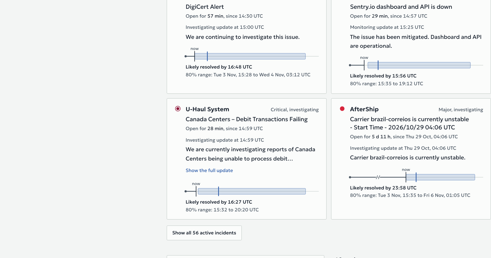
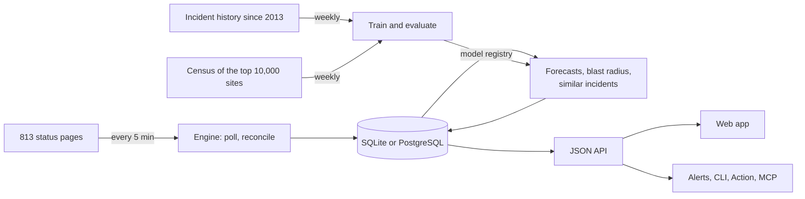

<p align="center">
  <picture>
    <source media="(prefers-color-scheme: dark)" srcset="docs/media/helicorder-dark.svg">
    
  </picture>
</p>

<h1 align="center">Mercalli</h1>

<p align="center"><strong>Outage intelligence for the services you depend on.</strong></p>

<p align="center">
  <a href="https://dharmeshdev1.github.io/mercalli/"><strong>Live site</strong></a> |
  <a href="docs/api.md">API</a> |
  <a href="docs/self-hosting.md">Self-host with alerts</a> |
  <a href="https://dharmeshdev1.github.io/mercalli/model/">Model card</a> |
  <a href="docs/architecture.md">Architecture</a>
</p>

<p align="center">
  <a href="https://github.com/dharmeshdev1/mercalli/actions/workflows/ci.yml"></a>
  <a href="https://github.com/dharmeshdev1/mercalli/actions/workflows/pipeline.yml"></a>
  <a href="https://github.com/dharmeshdev1/mercalli/actions/workflows/models.yml"></a>
  <a href="LICENSE"></a>
</p>

When a cloud, a CDN or a SaaS you rely on has a bad day, three questions matter: **what is broken,
how long will it last, and what else will it take down?** Mercalli answers all three, live, for
813 services, from their own public status pages.

<p align="center">
  <a href="https://dharmeshdev1.github.io/mercalli/">
    <picture>
      <source media="(prefers-color-scheme: dark)" srcset="docs/media/forecasts-dark.png">
      
    </picture>
  </a>
</p>

## What it does

- **Watches 813 status pages** every five minutes: 236 hand-picked clouds, CDNs, developer tools,
  AI APIs, payment and messaging providers, plus 577 more it found by itself among the 20,000 most
  visited domains. Every vendor's format is translated into one vocabulary.
- **Forecasts how long each open incident will last**, as a median and an 80% range that is
  calibrated on data the model never trained on: "likely resolved by 18:59 UTC, 80% range 18:30 to
  21:18". The forecast updates as the vendor posts updates.
- **Predicts what else an outage will hit.** When a cloud, CDN, DNS host or big platform has an
  incident, Mercalli ranks the services most likely to post an incident of their own that blames it
  within three hours, and says why: shared infrastructure, past co-failures, or the dependent's own
  incident reports naming the provider.
- **Maps who depends on whom.** A weekly census of the top 10,000 websites records which DNS host,
  edge network, cloud and region each one relies on.
- **Replays past cascades** reconstructed from status page history, like the AWS outage of
  20 October 2025, when 153 services posted incidents within three hours and 63 of them named AWS.
  A live **intensity** reading compares how disrupted things are now with every hour of the past
  year.
- **Runs itself.** A GitHub Actions pipeline polls, predicts and publishes every five minutes. Another
  refreshes history daily and retrains, evaluates and republishes the models every week. Nobody has
  to touch it.

## Use it

**On the web.** [dharmeshdev1.github.io/mercalli](https://dharmeshdev1.github.io/mercalli/) shows
everything above, updated every few minutes.

**From a script.** The [API](docs/api.md) is plain JSON with open CORS and no key:

```sh
curl -s https://dharmeshdev1.github.io/mercalli/api/v1/overview.json | jq '.active[] | {service_name, title, forecast}'
```

**From the terminal.**

```sh
uvx --from git+https://github.com/dharmeshdev1/mercalli mercalli status github aws cloudflare
```

**As a deploy gate.** Hold a deploy while a provider you depend on is down:

```yaml
- uses: dharmeshdev1/mercalli@v0.1.0
  with:
    services: github,aws,cloudflare,vercel
    fail-on: major
```

**From an AI agent.** `mercalli mcp` is a [Model Context Protocol](https://modelcontextprotocol.io)
server with four tools (`outages_now`, `check_services`, `incident_detail`, `dependencies`), so a
coding or operations agent can check outages before it acts:

```json
{"mcpServers": {"mercalli": {"command": "uvx", "args": ["--from", "git+https://github.com/dharmeshdev1/mercalli", "mercalli", "mcp"]}}}
```

**On your own infrastructure, with alerts.** The self-hosted edition polls every minute into
PostgreSQL, streams changes over server-sent events, exposes Prometheus metrics, and alerts Slack,
Discord, Microsoft Teams, PagerDuty, email or any webhook about the vendors in your stack:

```sh
git clone https://github.com/dharmeshdev1/mercalli && cd mercalli
MERCALLI_IMAGE=ghcr.io/dharmeshdev1/mercalli:0.1.0 docker compose -f deploy/docker-compose.yml up -d --no-build
```

[Self-hosting guide](docs/self-hosting.md), including a Helm chart for Kubernetes.

## How accurate it is

Every number here comes from a time split: the models trained on incidents that began before July
2025, calibrated on July to December 2025, and were tested only on what happened in 2026 (to
3 November). The data is 196,483 incidents from 789 status pages going back to 2013, 57,312 of them
with every vendor update. The [methodology](docs/methodology.md) has the details, and the live
[model card](https://dharmeshdev1.github.io/mercalli/model/) carries the current numbers, which the
weekly retraining rewrites.

**How long will it last?** On 30,131 forecasts across 11,390 incidents in the test period:

| Forecast of the time left | Typical error (mean absolute log error) | Within 2x of the truth | 80% range covers |
| --- | --- | --- | --- |
| **Mercalli** | **1.26** | **37.1%** | **80.4%** |
| Same phase, same time elapsed, historical median | 1.35 | 35.4% | |
| Median for the current phase | 1.50 | 31.6% | |
| The service's usual length, minus time elapsed | 2.01 | 26.3% | |

The honest summary: incident length is hard to predict from what vendors post, and Mercalli is only
modestly better than the best simple rule at the point estimate. Where it earns its keep is the
range, which is calibrated: its 80% range contained the real outcome 80.4% of the time on incidents
it had never seen, and 78.9% when made at the very first update.

**What else will it hit?** The test asks: when a provider such as a cloud, CDN or platform has an
incident, which other services will post an incident of their own within three hours that names that
provider? Over 86 such upstream incidents in 2026:

| Ranking of likely affected services | Share found in the top 10 | At least one right in the top 10 |
| --- | --- | --- |
| **Mercalli** | **61.3%** (95% CI 52 to 71) | **73.3%** (95% CI 64 to 83) |
| Services that named the provider before | 59.4% | 70.9% |
| Services that failed alongside it before | 3.9% | 5.8% |
| Services that use it for DNS, edge or hosting | 6.1% | 11.6% |
| Services that fail most often | 3.5% | 7.0% |

For major and critical upstream incidents (35 of them) the top 10 held 69.2% of the services that
went on to blame the provider. The intervals overlap with the strongest rule, so read this as "at
least as good as the best simple evidence, combined in one ranking", not as a large win. Two
negative results shaped the design: predicting any incident at all in the window only learns which
services fail often, and a larger model overfit the few hundred positive examples a year provides.

## What the data shows

- **AWS is the provider other companies blame most.** 323 services named it in 2,522 of their own
  incident reports. Next come Cloudflare (190 services), Google Cloud (114), Microsoft Azure (108)
  and GitHub (87).
- **The biggest cascades are visible from status pages alone.** Google Cloud on 12 June 2025: 191
  services posted incidents within three hours, 56 of them naming Google Cloud. AWS on
  7 December 2021: 117 services, 35 naming AWS.
- **6.5% of incidents are posted only after they are over**, so they can never be forecast while
  open. Mercalli records when it first saw each incident to keep that visible.
- **Two companies run the front door of a big share of the web.** Among the top 10,000 sites,
  Cloudflare answers DNS for 27.6% and AWS for 24.1%; Cloudflare's edge serves 29.9%. Of the
  AWS-hosted sites whose region is known, 51.8% are in us-east-1. (Census of 3 November 2026 from a
  GitHub-hosted runner in the US; [method and limits](docs/census.md).)

## How it works



One engine runs both editions. In the public edition, a scheduled GitHub Actions job runs one tick
against a SQLite file carried in the Actions cache and publishes the API as static files to GitHub
Pages, so it costs nothing and has nothing to attack. In the self-hosted edition the same engine runs
every minute inside a server. [Architecture](docs/architecture.md) covers the data model, failure
modes and scale, and the [decision records](docs/adr) explain the main choices.

## What it cannot do

- **It only knows what vendors publish.** An outage a vendor never posts is invisible, and a vendor
  that is slow to mark incidents resolved teaches the model to expect slow resolutions.
- **The blast radius is a prediction of what another vendor will post,** built from shared
  infrastructure and history. It is correlation with evidence, not proof of cause.
- **The public site is as fresh as GitHub's scheduler.** Five minute runs often start late at busy
  times. Self-host for one minute polling.
- **The census sees the web from GitHub's US runners.** Sites behind a CDN hide their origin, so
  hosting results describe what answers, not always where the application runs.

## Repository

| Path | What it is |
| --- | --- |
| [`src/mercalli/sources`](src/mercalli/sources) | Adapters for Atlassian Statuspage, status.io, AWS, Google Cloud, Azure, Slack and Heroku |
| [`src/mercalli/engine.py`](src/mercalli/engine.py) | One tick: poll, reconcile, run the models |
| [`src/mercalli/ml`](src/mercalli/ml) | Dataset, recovery forecaster, blast radius model, live evaluation |
| [`src/mercalli/census`](src/mercalli/census) | DNS, edge, cloud region, certificate and mail provider fingerprinting |
| [`src/mercalli/server`](src/mercalli/server), [`notify`](src/mercalli/notify) | The self-hosted server and alerting |
| [`web`](web) | The web app: Next.js, static export, the same build for both editions |
| [`catalog`](catalog) | The services watched, verified automatically each week |
| [`deploy`](deploy) | Docker Compose, Helm chart, Prometheus and Grafana |
| [`.github/workflows`](.github/workflows) | The live pipeline, weekly training, CI and releases |

```sh
uv sync --all-extras --group dev   # Python 3.12+
uv run pytest
uv run mercalli tick --publish site # one live tick, written to ./site
```

## Data and credits

Incident data comes from the public status pages of the services in
[`catalog/services.yaml`](catalog/services.yaml) and belongs to them. Mercalli links every incident
back to the vendor's page, requests each page once per tick with a User-Agent that points here, and
its published dataset carries titles, timings and statuses rather than the vendors' update text.
Domain ranks come from the [Tranco list](https://tranco-list.eu). Text embeddings use
all-MiniLM-L6-v2. Intervals use conformalized quantile regression (Romano, Patterson and Candes,
2019). See [NOTICE](NOTICE).

## License

[Apache 2.0](LICENSE).
