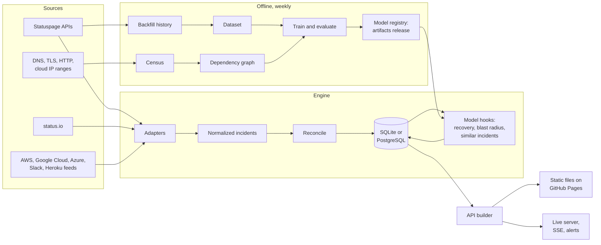

# Architecture

Mercalli turns the public status pages of hundreds of internet services into one live, queryable
picture: what is broken, how long it is likely to stay broken, and what else it is likely to break.
This document describes how the pieces fit, why they are shaped this way, and how they fail.

## The system on one page

## Components

| Component | Code | Job |
| --- | --- | --- |
| Catalog | `catalog/`, `src/mercalli/catalog.py`, `discover.py` | The services to watch, verified against their live status pages, plus pages found automatically among the top 20,000 domains |
| Adapters | `src/mercalli/sources/` | Translate each kind of status page into one vocabulary: `Incident`, `Update`, `Component`, `Snapshot` |
| Engine | `src/mercalli/engine.py` | One tick: poll every page concurrently, reconcile incidents, run the model hooks |
| Store | `src/mercalli/store.py` | SQLAlchemy models that run unchanged on SQLite and PostgreSQL |
| API builder | `src/mercalli/api.py`, `publish.py` | Builds every API document; writes them as static files or serves them live |
| Backfill and dataset | `src/mercalli/backfill.py`, `ml/dataset.py` | Download full incident histories into a raw cache, then rebuild analysis tables from it |
| Models | `src/mercalli/ml/` | Recovery forecaster, blast radius ranker, similar incident search, intensity calibration |
| Census | `src/mercalli/census/` | Which DNS, edge network, cloud and region each domain depends on |
| Server and alerts | `src/mercalli/server/`, `notify/` | The self-hosted edition: live API, event stream, Slack, Discord, Teams, PagerDuty, email and webhook alerts |
| Web app | `web/` | Next.js static export that reads the API, the same build for both editions |

## Two editions, one engine

The **public edition** costs nothing to run. A scheduled GitHub Actions workflow runs one engine tick
every five minutes against a SQLite file that travels between runs in the Actions cache, writes the
API as static JSON, and deploys it with the web app to GitHub Pages. Nothing is running between
ticks, so there is nothing to keep alive and nothing to attack.

The **self-hosted edition** runs the same engine every minute inside `mercalli serve`, against
PostgreSQL, and adds what a static site cannot do: a server-sent event stream, alerts for the
services in your stack, and Prometheus metrics. See [self-hosting](self-hosting.md).

The web app does not know which edition it talks to. Both serve the same documents at the same
paths ([API](api.md)), so there is one client to build and test.

## A tick, step by step

1. **Poll.** Every service is polled concurrently through one HTTP client with a global limit and a
   per-host limit, so a burst never lands on one vendor. Any failure becomes a snapshot that says
   so; nothing raises out of a poll.
2. **Record.** Each snapshot updates the service's current health and appends a poll row.
3. **Reconcile.** Every open incident in a snapshot is upserted. An incident the database holds as
   open that is missing from a successful snapshot has ended: the engine reads the vendor's recent
   list to learn the real resolution time, and only if that fails records the time it noticed,
   flagged `resolved_inferred`. A failed poll never resolves anything.
4. **Refresh.** A rotating slice of services has its recent incident list re-read every tick, so each
   service is re-read about once an hour. This catches incidents that vendors only post after they
   are over, which never appear as open.
5. **Model hooks.** The recovery forecaster scores open incidents that changed, the blast radius
   model ranks likely downstream services for open incidents at upstream providers, and similar
   past incidents are attached. A hook that fails is logged and skipped; it never stops collection.
6. **Publish.** The API documents are built from the database and swapped into place atomically.

Every step is idempotent: running a tick twice in a row changes nothing the second time.

## Data model

Incidents are keyed `service:vendor_id`. The vendor's own timestamps are kept separate from what
Mercalli observed:

- `created_at`, `started_at`, `resolved_at` come from the vendor. `started_at` can be earlier than
  `created_at` when the vendor backdates the start, and the start of an incident is the earlier of
  the two.
- `first_seen_at` and `last_seen_open_at` are Mercalli's own observations, which is what makes
  detection delays and retroactive incidents measurable.

Every forecast ever made is kept in `predictions`, so live accuracy is measured on what the model
actually said at the time, not on a replay.

## Offline pipeline

Once a day the Models workflow refreshes the raw history cache: for every Statuspage page it
re-reads the two newest history pages and fetches the full timeline of any incident it has not seen.
On Sundays it also rediscovers status pages, reruns the census, rebuilds the dataset, trains and
evaluates both models on a time split, retrains them for production on all data, and publishes the
artifacts to the `artifacts` release, which is the model registry. The live pipeline downloads the
current artifacts on every run, so a new model is live within five minutes of being published.

## Failure modes

| What fails | What happens |
| --- | --- |
| One status page is down or changes format | That service shows `unknown` after 30 minutes; every other service is unaffected |
| A vendor removes an incident without resolving it | It is closed with `resolved_inferred` and the time Mercalli noticed |
| The models or artifacts are missing | The engine runs without forecasts; the API carries `forecast: null` |
| A scheduled run is skipped or delayed | The next run catches up; state is the database, not the schedule |
| The Actions cache loses the engine state | The next run starts a fresh database; the hourly refresh rebuilds recent history within an hour, and older history comes from the dataset |
| The raw history cache is evicted | The next Models run rebuilds it from the vendors' pages in a few hours |

## Scale

One tick polls every service with one request each. On a laptop, 236 services take about 8
seconds; 800 take under 30. Storage grows with incidents, not with polls: polls and probes are
pruned after two days in the public edition. The heavy work, training and the census, runs weekly
and offline.
